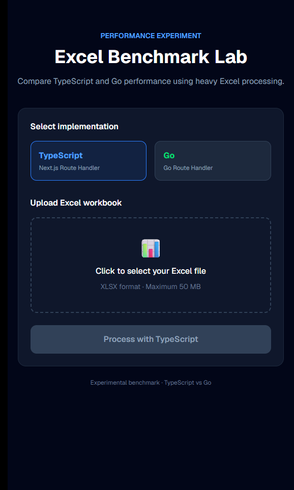

# Excel Benchmark Lab — Go vs TypeScript in Next.js

A practical performance experiment comparing Go and TypeScript for Excel processing inside a Next.js application.

The goal is to explore how Go performs compared with TypeScript when handling data-intensive backend operations in a Next.js project.

## 🖥️ Application Preview

<!-- Replace this placeholder with your actual screenshot -->

*Excel Benchmark Lab — select an implementation, upload an Excel workbook, and run the benchmark.*

## 🚀 Overview

This project contains two implementations of the same Excel-processing API:

- **TypeScript** using [ExcelJS](https://github.com/exceljs/exceljs)
- **Go** using [Excelize](https://github.com/qax-os/excelize)

Both implementations run within the same Next.js project and process uploaded Excel workbooks.

The application allows you to select an implementation, upload an `.xlsx` file, and compare the results.

## ✨ Features

- Compare Go and TypeScript Excel processing.
- Upload XLSX workbooks.
- Process large datasets.
- Calculate total revenue.
- Count transactions.
- Identify invalid rows.
- Generate a `Summary` worksheet.
- Measure execution time across processing stages.
- Compare output file sizes and calculated results.

## 🧪 Benchmark Scenario

The benchmark uses a synthetic Excel workbook with:

| Property | Value |
|---|---:|
| Data rows | 100,000 |
| Worksheets | 2 |
| Columns | 11 |
| Input file size | ~6.3 MB |
| File format | XLSX |

Both implementations perform the same logical operations:

1. Read the uploaded workbook.
2. Process transaction amounts.
3. Calculate total revenue.
4. Count transactions and invalid rows.
5. Generate a new `Summary` worksheet.
6. Return the updated workbook.

## 📊 Benchmark Results

The following results are averages from multiple runs in the same test environment.

| Metric | TypeScript | Go |
|---|---:|---:|
| Loading + Processing | 2,536.1 ms | 2,109.2 ms |
| ZIP Packaging | 2.9 ms | 5.7 ms |
| **Total Execution Time** | **2,562.5 ms** | **2,140.1 ms** |

### 🏆 Result

Go was approximately **16.5% faster overall** in this particular benchmark.

Average total execution time:

- TypeScript: 2.56 seconds
- Go: 2.14 seconds

**Important measurement detail:** ExcelJS performs much of its workbook parsing during the loading stage, while Excelize reads and parses rows during the processing stage. Therefore, comparing those individual stage measurements directly would be misleading.

For a fairer comparison, loading/opening and row processing are combined.

The total execution time is the main performance metric.

## ⚡ TypeScript ZIP Packaging Optimization

One of the most interesting parts of this experiment was optimizing the TypeScript implementation.

Initially, packaging the XLSX file was a significant bottleneck because the entire ZIP archive was being decompressed and recompressed.

I replaced that approach with a custom ZIP